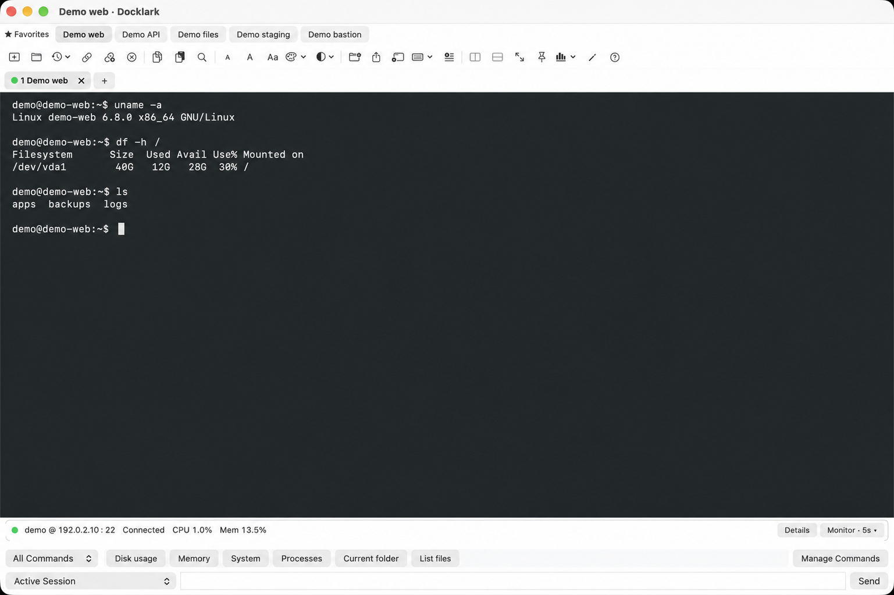

<strong>English</strong> · <a href="README.zh-CN.md">简体中文</a>

<h1 align="center">Docklark — SSH client for Mac</h1>

A native SSH workspace for Apple Silicon. Organize connections, work across sessions, and keep SFTP beside your terminal.

<a href="https://github.com/HarryAIDev/Docklark/releases/latest"><strong>Download for Apple Silicon</strong></a> · <a href="https://docklark.com/features/">Explore features</a> · <a href="https://docklark.com/docs/">Read the docs</a>

 

<picture><source media="(prefers-color-scheme: dark)" srcset="assets/en-workspace-dark.webp"></picture>

> Interface previews are reconstructions using fictional demo data. Features below describe development progress; they are not proof that every workflow has passed real-world testing or is included in a particular installer. See the [release notes](https://github.com/HarryAIDev/Docklark/releases) and [development progress](https://docklark.com/roadmap/).

## One workspace for everyday SSH work

Docklark grew out of moving from Windows to macOS and wanting a familiar, organized remote-work workflow. It brings connection management, terminal sessions, and file browsing into a native Mac interface.

- **Find the right connection:** saved SSH hosts, folders, favorites, and search; direct SSH and JumpServer entry points.
- **Keep related work together:** tabs, nested splits, and separate windows.
- **Move between commands and files:** dual-pane SFTP browsing with a transfer queue, progress, and cancellation.
- **Reuse commands deliberately:** saved commands and a shared command bar with selectable session targets.
- **Make the workspace yours:** light and dark appearances, terminal palettes, English and Simplified Chinese.

## A closer look

### 1. Start with organized connections

Keep frequently used connections in folders and use search or favorites to find them. Prepare the host, port, account, authentication method, and host-key fingerprint before connecting.

<picture><source media="(prefers-color-scheme: dark)" srcset="https://docklark.com/assets/product/en-connections-dark.webp"></picture>

[SSH setup guide](https://docklark.com/docs/ssh/) · [JumpServer guide](https://docklark.com/docs/jumpserver/)

### 2. Work across sessions

Use tabs for separate tasks and splits for side-by-side terminal work. Save recurring diagnostic commands in the quick command manager shown below. Choose the recipients in the shared command bar before sending a command to multiple sessions.

<picture><source media="(prefers-color-scheme: dark)" srcset="https://docklark.com/assets/product/en-commands-dark.webp"></picture>

### 3. Keep SFTP beside your terminal

Browse local and remote folders without leaving the workspace. Review the destination and transfer queue before uploading or downloading.

<picture><source media="(prefers-color-scheme: dark)" srcset="https://docklark.com/assets/product/en-sftp-dark.webp"></picture>

**Connection boundary:** SFTP and CPU/memory monitoring address the SSH entry host. They do not follow a nested SSH connection or a target asset selected inside JumpServer. Check the [feature details](https://docklark.com/features/) before choosing a workflow.

## Download and get started

[Docklark v0.2.61](https://github.com/HarryAIDev/Docklark/releases/tag/v0.2.61) provides an Apple Silicon (arm64) DMG, published October 18, 2026.

1. Open the release page and download the DMG and its SHA-256 checksum file.
2. Verify the checksum, then follow the [installation guide](https://docklark.com/download/).
3. Prepare an authorized SSH account and confirm the server's host-key fingerprint through a trusted channel.
4. Add a connection and start with one session before trying split panes or multi-session commands.

This release does not provide an Intel installer. Minimum macOS compatibility, signing, and notarization should not be assumed from the download alone; consult the release notes and installation guide. Never disable system security globally to open a download.

## Common questions

**Does macOS already include SSH?**  
Yes. Terminal's `ssh` command is useful for a quick connection. Docklark focuses on a graphical workflow for saved connections, multiple sessions, and SFTP.

**Is this an SFTP client for Mac too?**  
SFTP browsing and transfer controls are part of Docklark's development feature set. The SSH entry-host boundary above applies; validate your own connection and file-transfer workflow before relying on it.

**Is Docklark open source?**  
This repository hosts public releases, documentation, and feedback. The application source code is not published here. GitHub's automatically generated source archives contain this repository's documentation and assets, not the application source.

**Where can I learn more?**  
Start with the [documentation](https://docklark.com/docs/) and [feature overview](https://docklark.com/features/). The [roadmap](https://docklark.com/roadmap/) records daily feature progress rather than a guarantee of installer contents.

## Guides for Mac SSH and SFTP

[Choosing an SSH client for Mac](https://docklark.com/ssh-client-for-mac/) · [SFTP client for Mac](https://docklark.com/sftp-client-for-mac/) · [Practical SSH articles](https://docklark.com/blog/)

See the [illustrated workflow on the website](https://docklark.com/). It is a pausable interface explanation, not a recording of a live server session.

## Feedback

[Open an issue](https://github.com/HarryAIDev/Docklark/issues) or contact [Harry on X](https://x.com/HarryAIDev). Include the application version, macOS version, reproduction steps, and expected result. Remove passwords, private keys, tokens, sensitive host details, and personal file paths before sharing screenshots or logs.

Built by Harry, inspired by everyday remote work. <a href="https://docklark.com/">docklark.com</a>

