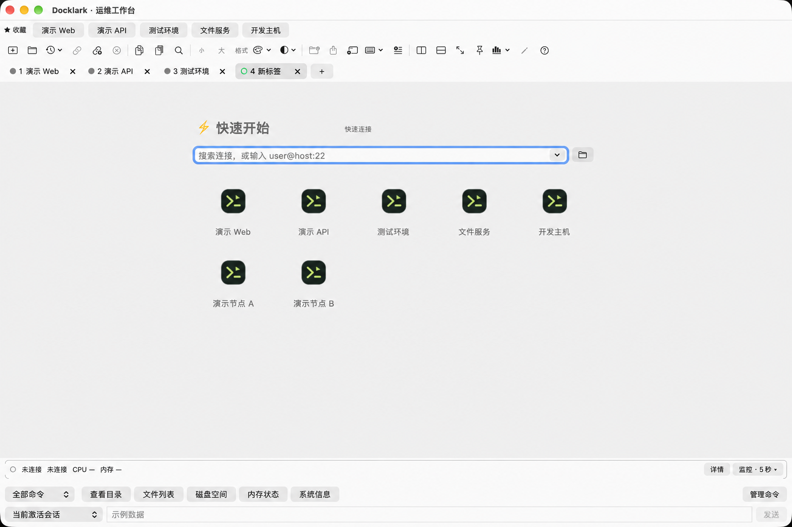

<a href="README.md">English</a> · <strong>简体中文</strong>

<h1 align="center">Docklark — Mac SSH 客户端</h1>

为 Apple Silicon 打造的原生 SSH 工作台。 整理连接、处理多个会话，让 SFTP 文件传输就在终端旁。

<a href="https://github.com/HarryAIDev/Docklark/releases/latest"><strong>下载 Apple Silicon 版本</strong></a> · <a href="https://docklark.com/zh/features/">了解功能</a> · <a href="https://docklark.com/zh/docs/">使用文档</a>

 

<picture><source media="(prefers-color-scheme: dark)" srcset="assets/zh-workspace-dark.webp"></picture>

> 界面预览为采用虚构演示数据重建的图示。下文功能描述开发进展，不代表所有流程均已通过真实场景验收，也不代表已确认包含在某个安装包中。请结合[版本说明](https://github.com/HarryAIDev/Docklark/releases)与[开发进展](https://docklark.com/zh/roadmap/)查看。

## 把日常 SSH 工作放在一起

从 Windows 转到 macOS 后，希望找回熟悉、有条理的远程工作体验，这就是 Docklark 的起点。连接管理、终端会话与文件浏览，集中在原生 Mac 界面中。

- **快速找到连接：** 保存 SSH 主机，按目录整理，配合收藏与搜索；支持直连 SSH 和 JumpServer 入口。
- **把相关任务放在一起：** 标签、嵌套分屏与独立窗口。
- **在命令与文件间切换：** SFTP 双栏浏览、传输队列、进度与取消操作。
- **有选择地复用命令：** 快捷命令与统一撰写栏，发送前选择目标会话。
- **调整为顺手的外观：** 浅色与深色模式、终端配色、英文及简体中文。

## 看看日常工作流

### 1. 先把连接整理好

通过目录整理常用连接，用搜索与收藏快速找到目标。连接前准备主机、端口、账号、认证方式，并确认主机指纹。

<picture><source media="(prefers-color-scheme: dark)" srcset="https://docklark.com/assets/product/zh-connections-dark.webp"></picture>

[直连 SSH 指南](https://docklark.com/zh/docs/ssh/) · [JumpServer 指南](https://docklark.com/zh/docs/jumpserver/)

### 2. 在多个会话间处理任务

用标签分开不同任务，用分屏并排查看终端。下图的快捷命令管理可用于保存常用诊断命令。需要向多个会话发送命令时，先在统一撰写栏中确认接收目标。

<picture><source media="(prefers-color-scheme: dark)" srcset="https://docklark.com/assets/product/zh-commands-dark.webp"></picture>

### 3. 文件传输就在终端旁

在工作台内浏览本地与远端目录。上传或下载前，先核对目标路径与传输队列。

<picture><source media="(prefers-color-scheme: dark)" srcset="https://docklark.com/assets/product/zh-sftp-dark.webp"></picture>

**连接边界：** SFTP 与 CPU、内存监控作用于 SSH 入口主机，不会跟随嵌套 SSH，也不会自动切换到 JumpServer 内选中的目标资产。选择工作流前，请查看[完整功能说明](https://docklark.com/zh/features/)。

## 下载并开始使用

[Docklark v0.2.61](https://github.com/HarryAIDev/Docklark/releases/tag/v0.2.61) 于 2026 年 10 月 18 日提供 Apple Silicon（arm64）DMG 安装包。

1. 打开版本页面，下载 DMG 及对应的 SHA-256 校验文件。
2. 核对校验值，然后按照[安装指南](https://docklark.com/zh/download/)操作。
3. 准备有访问权限的 SSH 账号，通过可信渠道确认服务器主机指纹。
4. 添加连接，先尝试单会话，再使用分屏或多会话命令。

此版本未提供 Intel 安装包。不能仅凭可下载就推定最低 macOS 兼容性、签名或公证状态，请查看版本说明与安装指南。不要为了打开下载的软件而全局关闭系统安全功能。

## 常见问题

**macOS 不是已经自带 SSH 了吗？**  
是的，终端中的 `ssh` 命令适合快速连接。Docklark 侧重保存连接、多会话与 SFTP 集成的图形化工作流。

**它也能作为 Mac SFTP 客户端使用吗？**  
SFTP 浏览与传输控制属于 Docklark 的开发功能。使用时仍需注意上文的 SSH 入口主机边界，并验证自己的连接与文件传输流程。

**Docklark 开源了吗？**  
本仓库用于公开版本发布、使用说明与问题反馈，不包含应用源码。GitHub 自动生成的源码压缩包包含的是本仓库的文档和素材，并不是应用源码。

**哪里可以了解更多？**  
可以从[使用文档](https://docklark.com/zh/docs/)与[功能介绍](https://docklark.com/zh/features/)开始。[开发路线](https://docklark.com/zh/roadmap/)按天记录功能进展，不构成安装包功能清单的保证。

## Mac SSH 与 SFTP 指南

[选择 Mac SSH 客户端](https://docklark.com/zh/ssh-client-for-mac/) · [Mac SFTP 客户端指南](https://docklark.com/zh/sftp-client-for-mac/) · [SSH 实用文章](https://docklark.com/zh/blog/)

也可以查看[官网的工作流图解](https://docklark.com/zh/)。它是可暂停的界面说明动画，不是真实服务器会话录屏。

## 反馈与交流

欢迎[提交 Issue](https://github.com/HarryAIDev/Docklark/issues)，或[通过 X 联系 Harry](https://x.com/HarryAIDev)。请提供应用版本、macOS 版本、复现步骤和预期结果。分享截图与日志前，请移除密码、私钥、令牌、敏感主机信息与个人文件路径。

由 Harry 打造，源于日常远程工作的需要。 <a href="https://docklark.com/zh/">docklark.com</a>

